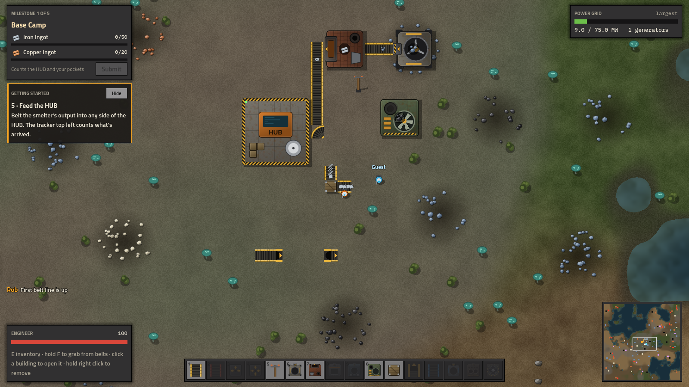
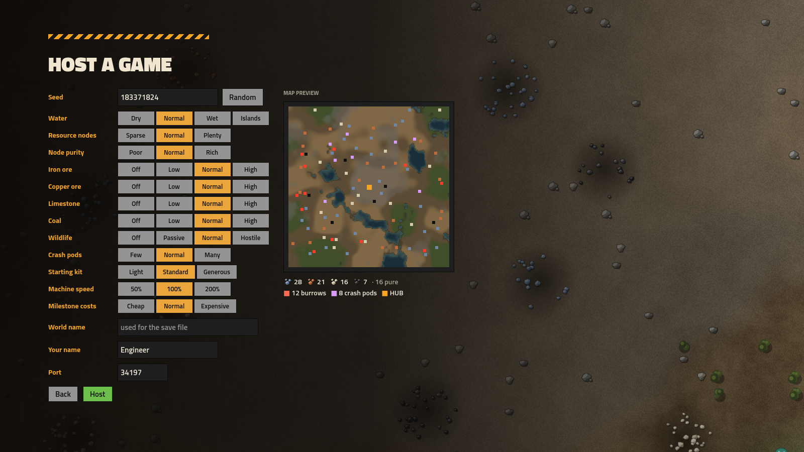

# Ferrum Frontier

A top-down factory builder with Factorio's look and grid, plus Satisfactory's resource nodes, overclocking, milestones and a Space Elevator to build. Play alone or with friends over your network.



## Download

Get the latest `FerrumFrontier.exe` from the **[Releases](../../releases)** page. It's a single file with nothing to install; save it anywhere and run it.

Windows will warn that the app isn't recognised, because the build isn't code-signed yet. Click **More info → Run anyway**.

## What's in it

- **Resource nodes** come in Impure, Normal and Pure. They never run out; place miners on them.
- **Belts**, from Mk.1 to Mk.3, plus splitters, mergers, underground belts and storage crates.
- **Production chain:** ore → ingots → plates, rods, screws, wire and cable → reinforced plates, rotors and modular frames → steel → stators → Space Elevator parts.
- **Power** from coal generators, carried by pole networks. Machines slow down when the grid is overloaded.
- **Overclocking** from 1% to 250%, using Power Shards from burrows and crash pods.
- **Milestones** unlock new buildings. Data Drives unlock alternate recipes. The goal is a three-phase Space Elevator.
- **Wildlife** guards the richest nodes. Your zapper fires on its own.
- **Seeded worlds** with a live map preview, and tuning for water, node count, purity, each ore type, wildlife, crash pods, starting kit, machine speed and milestone costs.
- **Multiplayer:** one PC hosts and the others join by IP address. It includes chat, map pings, and automatic router port opening (UPnP).
- **Named save slots** with three rotating autosaves per world.
- **Sound and music**, a settings menu (name, volumes, fullscreen, interface size) and a first-time hint panel.



## Controls

| Key | Action |
|---|---|
| W A S D | Walk. The zapper fires on its own at wildlife in range. |
| 1–0, or click the bar | Pick a building |
| R / Shift+R | Rotate the held building, or rotate the one under the cursor |
| Q | Pick up the hovered building type, or clear your hand |
| Left click | Place, or open a building. Drag to lay belts or a line of poles. Hold on an ore node to mine by hand. |
| Hold right click | Deconstruct, with a full refund |
| Shift + right / left click | Copy / paste a machine's recipe and clock speed |
| Hold F | Grab items off belts around you and under the cursor |
| E | Inventory and hand crafting |
| Enter | Chat |
| G or middle click | Ping a spot on the map |
| Alt | Toggle recipe icons on machines |
| Esc | Close the window, clear your hand, or open the menu |
| Mouse wheel | Zoom |

## Playing together

1. **The host** clicks **Host game**, picks the world settings, and clicks **Host**. The player list in the bottom right shows the address to share, with a Copy button.
2. **Friends** click **Join game** and enter that address.

On the same network this works straight away. Over the internet, the game tries to open UDP port 34197 on the host's router automatically. If the router won't allow it, forward the port by hand or use Tailscale.

Everyone must run the same version, and the game refuses mismatches. [docs/MULTIPLAYER.md](docs/MULTIPLAYER.md) explains how it works.

## Building from source

1. Install **[Godot 4.4](https://godotengine.org/download)**, the standard build (not .NET).
2. Clone this repo, open Godot, and **Import** `project.godot`. The first open imports the assets.
3. Press **F5** to run.

To make the exe: **Editor → Manage Export Templates → Download and Install**, then **Project → Export → Windows Desktop → Export Project**. The game data is embedded, so the result is a single `build/windows/FerrumFrontier.exe`. Before handing out a build, bump `VERSION` in `scripts/data.gd` so mismatched builds are refused.

### Tests

```
godot --headless --path . -- --selftest
godot --headless --path . -- --nettest=host &
godot --headless --path . -- --nettest=client
```

The self-test checks:
- production rates
- belts, crates and underground belts
- determinism
- exact save/load round trips

The net test runs a real host and client against each other and prints matching state checksums.

### Layout

```
scripts/
  data.gd        items, recipes, buildings, milestones, world settings
  world.gd       seeded map generation (staged, for the loading screen)
  sim.gd         the game state and 60 Hz tick: commands in, events out
  net.gd         host-relayed lockstep multiplayer over ENet, UPnP
  main.gd        game loop, input, save slots, loading flows
  world_view.gd  draws the world (reads the sim, never writes it)
  hud.gd         all menus and HUD panels
  audio.gd       sound effects, factory hum, music
shaders/terrain.gdshader   ground colour, computed on the GPU
assets/                    sprites, sounds, music, fonts
docs/                      roadmap, multiplayer notes, screenshots
```

## Roadmap

See **[docs/ROADMAP.md](docs/ROADMAP.md)**. Phase 1 (v0.4) is done. Next up is Phase 2: production statistics, fluids and the oil chain.

## Credits

- **Fonts:** [Titillium Web](https://fonts.google.com/specimen/Titillium+Web) and [IBM Plex Mono](https://fonts.google.com/specimen/IBM+Plex+Mono), both under the SIL Open Font License.
- **Engine:** [Godot](https://godotengine.org), MIT licence.
